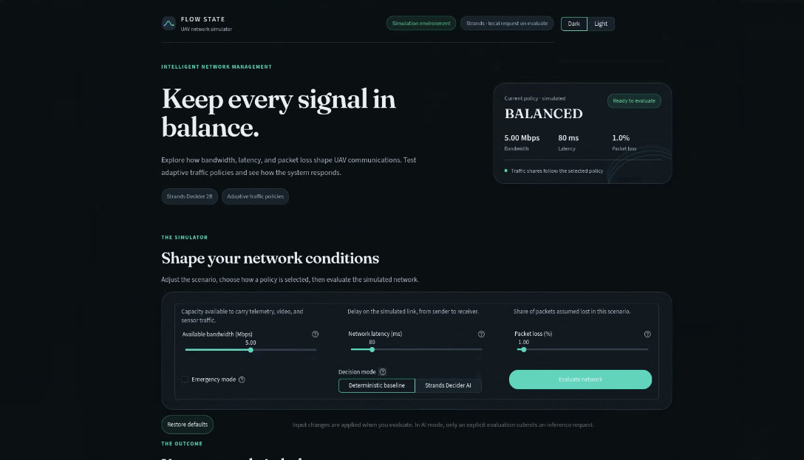

# FLOW STATE

**Explainable bandwidth management for UAV networks.**

FLOW STATE is a Streamlit simulator for testing how a UAV network can allocate limited bandwidth across telemetry, video, and sensor traffic. Configure bandwidth, latency, packet loss, and emergency mode, then compare a deterministic baseline with a Strands Decider recommendation.



> **Scope:** Network conditions, traffic allocations, and performance metrics are simulated. FLOW STATE does not control real UAVs, and its dashboard metrics are not field measurements.

## What it does

- **Policy selection:** Compares four policies: `BALANCED`, `PROTECT_TELEMETRY`, `REDUCE_VIDEO`, and `DEFER_SENSORS`.
- **AI integration:** Can request a typed policy choice from a separately running Strands Decider service.
- **Safety and fallback:** Validates the response, restricts choices to supported policies, applies the emergency override, and can fall back to the deterministic baseline.
- **Evaluation:** Uses shared allocation and metrics code to compare decisions under the same simulated inputs.
- **Repeatable testing:** Includes seeded scenarios and offline tests that do not need a running model service.

## How it is organised

| File | Role |
|---|---|
| `app.py` | Streamlit dashboard |
| `decisions.py` | Deterministic policy rules and action mappings |
| `ai_agent.py` | Strands service adapter, validation, and fallback |
| `scheduler.py` | Traffic allocation |
| `metrics.py` | Simulated performance metrics and policy comparisons |
| `simulator.py` | Repeatable network scenarios |
| `styles.css` | Dashboard styling |

## Run on Windows

Open **PowerShell** in the project folder.

```powershell
# Create and activate a virtual environment
py -m venv .venv
.\.venv\Scripts\Activate.ps1

# Install the project dependencies
python -m pip install -r requirements.txt

# Start the dashboard
python -m streamlit run app.py
```

Streamlit prints a local URL in the terminal, usually `http://localhost:8501`. Open that URL in your browser.

If PowerShell blocks environment activation, you can run the environment's Python directly instead:

```powershell
.\.venv\Scripts\python.exe -m pip install -r requirements.txt
.\.venv\Scripts\python.exe -m streamlit run app.py
```

## Enable Strands Decider mode

The Strands Decider model server runs separately from the dashboard. If it is already running, leave it running and open a **second PowerShell window** for FLOW STATE.

Set the service address for the current PowerShell session:

```powershell
$env:FLOW_STATE_AI_URL = "http://127.0.0.1:8000"
$env:FLOW_STATE_AI_TIMEOUT_SECONDS = "30"
python -m streamlit run app.py
```

Check that the service is ready:

```powershell
curl.exe -fsS http://127.0.0.1:8000/health
```

The service and its model weights must already be installed and available. Starting the dashboard does not download the model or launch the Strands service. If the service is unavailable, the app can use the deterministic baseline when fallback is enabled.

In the dashboard, choose **Deterministic baseline** to run without model inference, or **Strands Decider AI** to request a model decision. Check the displayed decision source and fallback status; selecting AI mode alone does not prove that inference succeeded.

## Test and evaluate

Run the offline test suite from the project folder:

```powershell
python -m unittest discover -v
```

Generate the deterministic baseline evaluation report:

```powershell
python scripts/evaluate_offline.py
```

The evaluation metrics are simulated. A live-service evaluation is separate and requires a running Strands service.

## Built with

Python · Streamlit · Requests · Strands Decider

**Project repository:** [suhailh3005-creator/flow-state](https://github.com/suhailh3005-creator/flow-state)  
**Strands Decider:** [Official repository](https://github.com/strands-labs/strands-decider) · [Model checkpoint](https://huggingface.co/StrandsAgents/strands-decider-2B-qwen3.5-v1-2610)

---

*Prioritise what matters. Keep the mission moving.*
